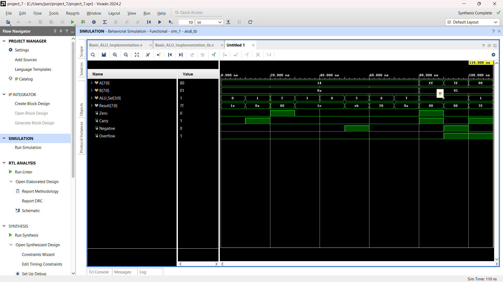
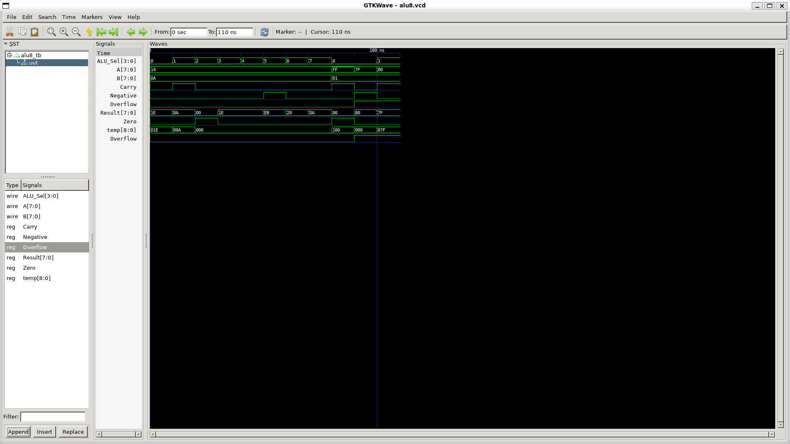
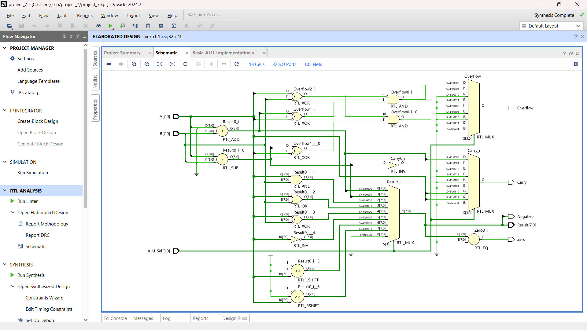

# 8-Bit ALU Implementation Using Verilog HDL

## Project Details
- Intern ID: CITS8975
- Name: Pyla Naveen
- Project: Basic ALU Implementation

## Project Scope
Design and simulation of an 8-bit Arithmetic Logic Unit using Verilog HDL.

## Operations
1. Addition
2. Subtraction
3. Bitwise AND
4. Bitwise OR
5. Bitwise XOR
6. Bitwise NOT
7. Logical Left Shift
8. Logical Right Shift

## Status Flags
- Zero Flag
- Carry Flag
- Negative Flag
- Overflow Flag

## Tools Used
- Xilinx Vivado 2024.2
- Ubuntu
- Verilog HDL
- Icarus Verilog
- GTKWave

## Project Structure
- Verilog: ALU source code
- Testbench: Verification code
- Simulation: Simulation files and screenshots
- RTL_Schematic: Vivado RTL schematic
- Documentation: Supporting documents

## Simulation Commands
Run these commands from the Simulation directory:

1. iverilog -g2012 -o alu8_sim ../Verilog/alu8.v ../Testbench/alu8_tb.v
2. vvp alu8_sim
3. gtkwave alu8.vcd

## Project Evidence
### Vivado Behavioral Simulation

### GTKWave Simulation

### RTL Schematic

## Results
The ALU was successfully compiled and simulated. The eight operations and status flags were tested using the Verilog testbench.

## Author
Pyla Naveen
